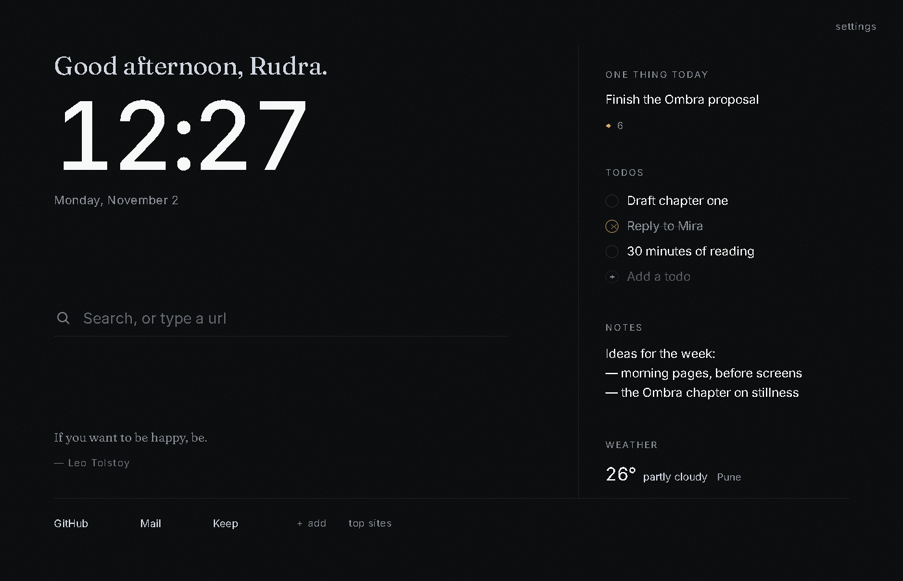
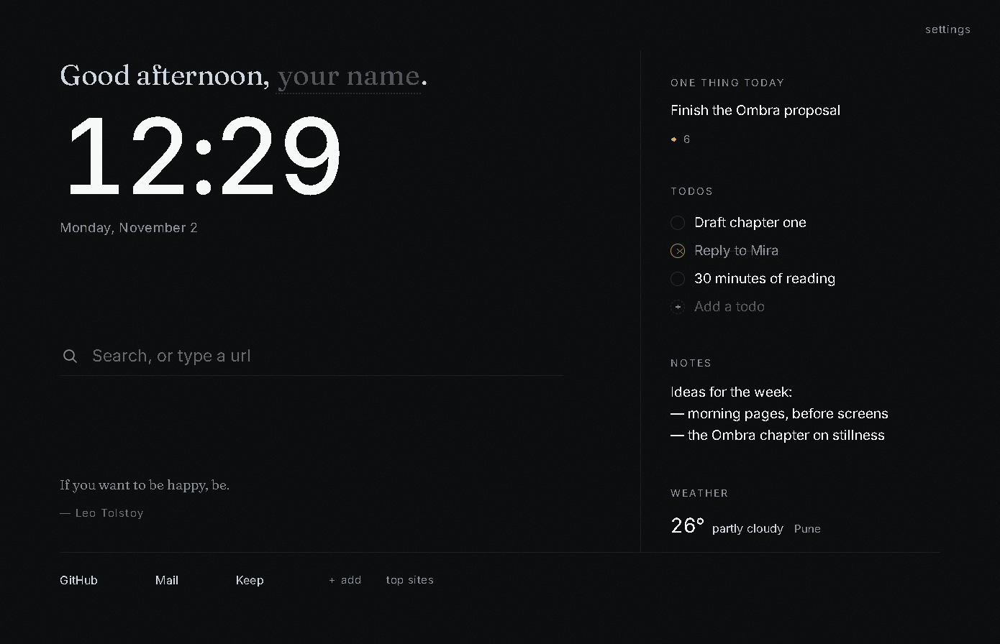
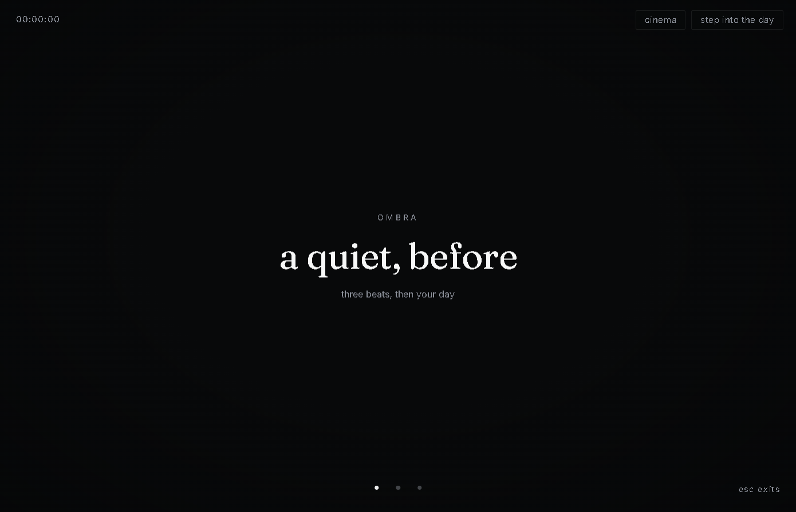
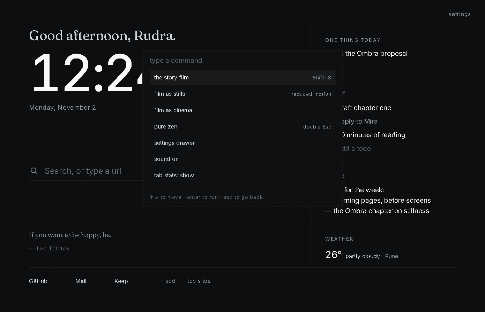
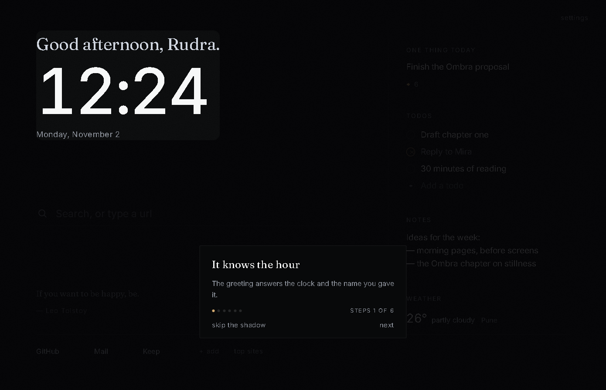

# Ombra

*A quieter new tab.*

A zen, deeply dark new-tab extension that plays like a film: bundled scenes,
cinematic scroll stories, offline ambience. Local-first — no accounts, no
analytics, no cloud.



The unnamed greeting leaves a blank to be filled — that is the whole ask:



Press <kbd>Shift</kbd>+<kbd>S</kbd> and the tab becomes a story film:



<kbd>Ctrl</kbd>+<kbd>Shift</kbd>+<kbd>P</kbd> opens a memory over everything:



A first shadow walks the stage once, quietly, then never again:



## Install — from a release (easiest)

1. Open the [latest release](https://github.com/rudra-th/Ombra/releases/latest)
   and download `ombra-1.0.0-chrome.zip`.
2. Unzip it somewhere you will keep (anywhere works; the folder must stay).
3. Visit `chrome://extensions`, turn on **Developer mode** (top right).
4. Click **Load unpacked** and pick the unzipped folder (the one holding
   `manifest.json`).
5. Ombra now owns your new tab. If Chrome shows a *"Change back to Google?"*
   bar, choose **Keep it** — it only asks once, and respects the answer.

### After install, twice

- The greeting will ask your name. Type it; the surface answers. Skip it;
  the blank keeps waiting.
- A first shadow tours the surface ~2s after arrival — Esc skips, arrows
  walk. It marks itself seen and returns only by palette replay.

Updates: download a newer release, replace the folder, hit the reload
icon on `chrome://extensions`. Your words carry over — they live in your
browser's storage, not the folder.

## Install — from source

```bash
git clone https://github.com/rudra-th/Ombra
cd ombra
npm install      # also runs `wxt prepare`
npm run build    # → .output/chrome-mv3
```

Then **Load unpacked** → `.output/chrome-mv3` as above.

## Building and developing

```bash
npm run dev       # WXT dev — opens Chrome with the unpacked extension, HMR on
npm run compile   # typecheck (wxt prepare + tsc --noEmit)
npm test          # vitest — 162 seams
npm run zip       # store-ready artifact → .output/ombra-<v>-chrome.zip
node scripts/make-icons.mjs   # re-render the emblem (pure node, no deps)
```

> Chrome allows only one extension to hold the new tab. When the
> "Change back to Google?" bar appears, choose **Keep it**.

## What stays where

- **Never leaves your browser:** notes, todos, intentions, links, tab
  stats, the film's shape — `chrome.storage.local`, uninstall wipes it.
- **Rides your own Chrome Sync:** preferences only — your name, accent,
  sound choices (`chrome.storage.sync`).
- **Leaves the device, twice, both yours:** a weather question to
  open-meteo.com (city you typed, no account), and the search-engine
  navigation you choose. Details: [privacy statement](docs/PRIVACY.md).

## Stack

| Layer | Choice |
|---|---|
| Framework | [WXT](https://wxt.dev) + React 19 + TypeScript |
| Motion | native CSS scroll-driven timelines + hand-rolled spotlight; zero animation dependencies |
| Type | Fraunces (display) · Inter (UI, `tnum`) — bundled woff2, zero remote fonts |
| Audio | Web Audio, procedurally composed; armed on first gesture, silent by default |
| Storage | `chrome.storage.sync` (settings) + `local` (everything else) — local-first |

## The repo map

- [`docs/PLAN.md`](docs/PLAN.md) — the six phases and their honesty notes
- [`docs/STORE.md`](docs/STORE.md) — the Chrome Web Store listing, pre-composed
- [`docs/PRIVACY.md`](docs/PRIVACY.md) — what leaves the device, plainly
- `docs/assets/` — the five listing frames

## License

[MIT](LICENSE).
